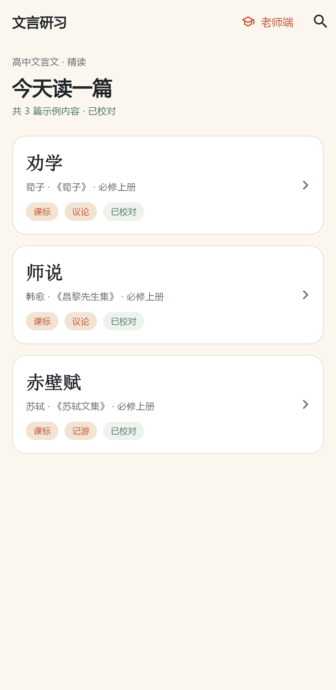
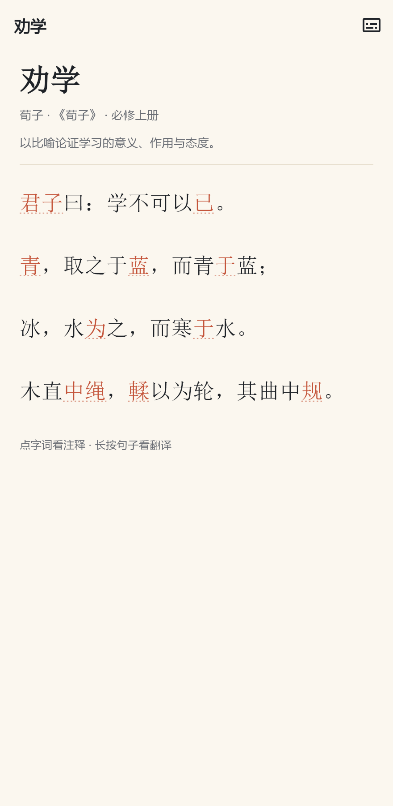
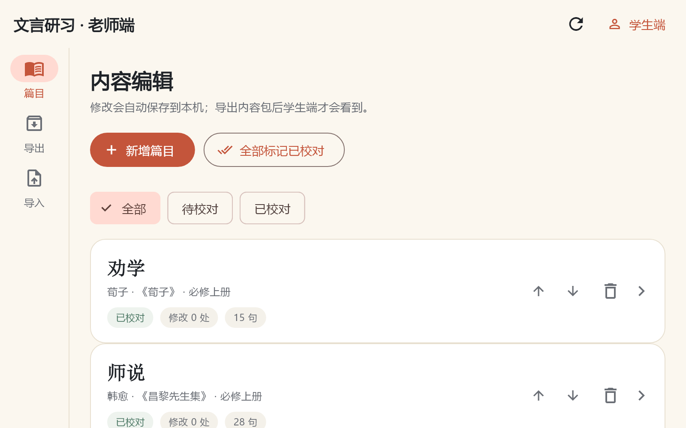

# 文言研习

面向高中文言文的**离线学习 App**：Android 学生端 + Windows 老师端，一套 Flutter 代码。
学生读课文、背字词、刷题、看词义专项；老师在 Windows 上编辑内容、校对、出题、导出内容包。
**完全离线，无需服务器，无运行时 AI。**

## 功能

### 学生端（Android）

- 课文阅读：逐句译文、点词看注释、字号/行距调节
- 字词卡：SRS 间隔复习（简化 SM-2）
- 刷题：词义选择、错题本、错题重练、今日统计
- 词义专项：熟词生义 / 一词多义 / 古今异义，可浏览 + 自测
- 内容包 `.wyc` 导入，覆盖安装不丢数据

### 老师端（Windows）

- 篇目 / 句子 / 词条 新增、删除、编辑
- 自定义题目（题干、加点词、正确释义、干扰项、解析）
- 批量校对、全部/待校对/已校对筛选、篇目排序
- 快捷键：Ctrl+Enter 校对、Ctrl+P 预览、Ctrl+K 课堂
- 导出 `.wyc` 内容包（含自定义题目），学生导入后即可看到

### 课堂模式

全屏逐句展示、注释/译文开关、翻句，适合投屏。

## 截图

| 学生首页 | 阅读页 | 老师端 |
|---|---|---|
|  |  |  |

更多界面见 [docs/mockups/out/](docs/mockups/out/)。

## 当前状态

- 版本：`v0.1.16`
- 内置内容：**35 篇 / 994 句 / 4804 个逐词注释**
- 词义训练：熟词生义 40、一词多义 25 词（80 义项）、古今异义 30
- 测试：19 个 Flutter 测试通过
- 已完成：M0 环境、M1 内容与阅读、M2 字词卡/SRS/刷题/统计、M3 老师端
- 进行中：M4 课堂模式打磨

## 技术栈

- Flutter 3.47.x / Dart 3.13
- 纯 Dart 依赖（`archive`、`crypto`），无原生插件依赖
- 本地 JSON 存储，Android 数据目录 / Windows `%APPDATA%\wenyan`
- 内容包 `.wyc` = ZIP + `manifest.json` + `content/index.json` + 课文 JSON + `questions.json`，SHA-256 校验

## 目录结构

```text
app/                 Flutter 应用（Android / Windows）
  lib/               源码：页面、服务、模型
  assets/content/    35 篇课文 JSON + index.json
  assets/training/   词义训练题库
  test/              Flutter 测试
  tool/              预览截图 / 校对工具
content/             内容生产规范与元数据
docs/                方案、格式、构建、老师端使用、内容清单
tools/               校验与打包脚本（Python）
release/             本地构建产物（不提交，用 Releases 分发）
```

## 构建

```bash
cd app
flutter pub get
flutter test
flutter build apk --release        # Android
flutter build windows --debug      # Windows 老师端
```

内容校验与打包：

```bash
python tools/validate_content.py
python tools/pack_content.py
```

详细步骤见 [构建与发布](docs/构建与发布.md)。

## 内容说明

- 内容为 AI 辅助起草 + 结构化校验（字段、token 顺序、译文/释义完整性），**不代表逐条学术审定**。
- 正式用于教学前，建议老师用老师端抽检释义与译文。
- 欢迎通过 Issue / PR 提交纠错；内容 JSON 集中在 `app/assets/content/lessons/`。

## 文档

- [方案与实施计划](docs/方案与实施计划.md)
- [内容格式 v1](docs/内容格式.md)
- [内容清单](docs/内容清单.md)
- [老师端使用说明](docs/老师端使用.md)
- [导入内容包](docs/导入内容包.md)
- [构建与发布](docs/构建与发布.md)
- [环境与工具清单](docs/环境与工具清单.md)

## License

[MIT](LICENSE)

## 免责声明

本项目为学习工具，课文原文与注释仅供学习参考；教材篇目版权归原权利人所有。
