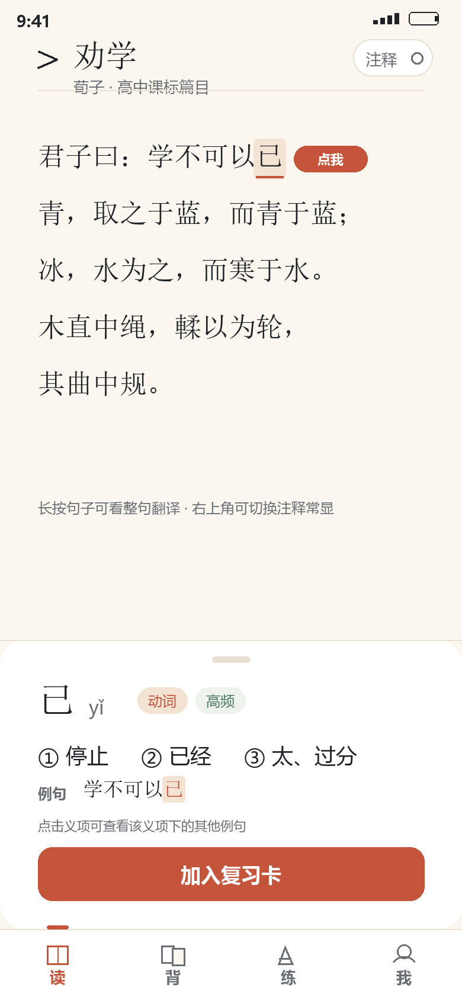
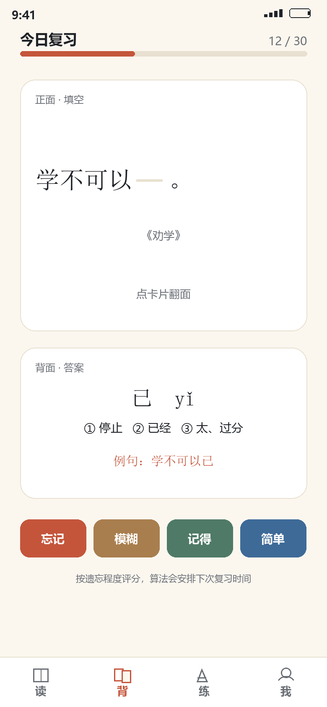
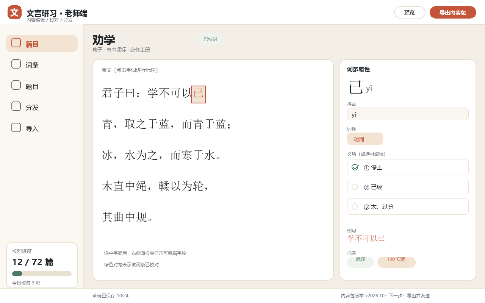

# 文言研习（暂定名）— 方案与实施计划

> 版本 v0.1 · 2026-10-24 · 状态：讨论稿（待确认）
> 项目代号：**wenyan** · 本文档描述的是**全新项目**，与工作区内其他项目无任何关联。

## 0. 一分钟摘要

- 一个**高中文言文**学习工具：学生手机端课后自学/刷题，老师 Windows 端编辑、校对、投屏。
- **完全离线、无服务器**：数据只存本机；内容更新靠"内容包 + 安装包"手动分发。
- 一套 **Flutter** 代码，同时产出 Android APK 与 Windows 程序（iOS 第一版不做）。
- 界面强调**图形化**：点词出义、卡片翻转、进度可视化、拖拽式编辑，尽量少打字。
- 内容由 AI 生成初稿、**老师校对**；程序只内置"已校对"版本。

## 1. 项目定位

### 1.1 是什么

面向高中（课标推荐篇目 + 120 个实词 / 18 个虚词）的文言文精读、背诵、刷题工具；同时是老师的备课、校对与课堂投屏工具。

### 1.2 不是什么

- 不是网课平台：不做账号、班级、作业提交
- 不是通用古籍阅读器：不做全库、不做繁体竖排
- 不是 AI 陪聊 / 自动翻译批改工具
- 第一版不是 iOS 应用

### 1.3 设计原则

1. **离线优先**：没有网络权限也能完整使用
2. **图形优先**：能用点按 / 拖拽完成的，不让用户输入
3. **内容可校对**：每条内容有"校对状态"，学生只看到已校对内容
4. **程序与内容分离**：内容包可独立更新，不必重装 APP
5. **老师零技术门槛**：安装、校对、导出三步完成
6. **克制**：第一版砍掉一切非核心功能

## 2. 用户与场景

| 角色 | 设备 | 场景 | 核心需求 |
|---|---|---|---|
| 学生 | Android 手机 | 课后在家 | 读得懂、记得住、练得会 |
| 老师 | Windows 电脑 | 备课、校对、课堂 | 改得动、看得清、发得出 |
| 维护者（你） | Windows | 构建与发布 | 可维护、可迭代 |

典型流程：

1. 老师打开 Windows 端 → 校对 AI 生成的注释与题目 → 导出内容包
2. 老师在班级群发内容包（或新安装包）
3. 学生导入 → 精读 → 生词自动入卡 → 复习 → 刷题 → 错题本
4. 老师上课用"课堂模式"投屏讲解

## 3. 范围

### 3.1 第一版必做（MVP）

- **学生端**：篇目列表、阅读页（点词出义 / 注释开关 / 整句翻译）、字词卡（SRS）、刷题（5 类题型）、错题本、搜索、背诵辅助（挖空 / 默写 / 上下句）、导入内容包、学习统计
- **老师端**：篇目·词条·题目编辑、校对队列与进度、导出 / 导入内容包、课堂模式
- **系统**：离线存储、备份导出、内容包版本校验

### 3.2 第一版不做

朗读 / 听读、翻译自动判分、自动组卷打印、学生学习数据汇总、云同步与账号、iOS、运行时 AI 问答、繁体与竖排、多语言。

### 3.3 后续候选

- **v1.5**：内容包增量更新、老师端批量校对工具、错题导出
- **v2**：可选静态托管自动更新、网页版（覆盖 iPhone）、可选的联网 AI 辅助

## 4. 功能清单

### 4.1 学生端（底部四个入口：读 / 背 / 练 / 我）

**4.1.1 读**

- 篇目列表：按分册 / 课标 / 体裁筛选，卡片显示学习进度环
- 阅读页：正文大字逐句排列；点词 → 底部抽屉（拼音、词性、义项、例句、标签）；长按句子 → 整句翻译；右上角"注释常显"开关；字号 / 行距 / 背景可调
- 生词自动入卡：第一次点开的词条进入"待学"，按设置每天转入复习
- 搜索：按字 / 词 / 篇检索义项与例句

**4.1.2 背**

- 字词卡：正面挖空例句、背面答案；四档评分（忘记 / 模糊 / 记得 / 简单）；FSRS 排程
- 背诵辅助：挖空填空、默写输入（自动比对、差异高亮）、上下句提示
- 今日任务：新卡 + 到期复习 + 背诵任务，进度可视化

**4.1.3 练**

- 题型：词义选择、断句选择、默写填空、文化常识、语法判断
- 组卷逻辑：按篇 / 按词 / 按考点，一次 10 题
- 即时判分 + 解析；错题自动入错题本；错题 3 天后重练

**4.1.4 我**

- 学习统计（连续天数、热力图、正确率）
- 错题本（按篇 / 题型筛选）
- 导入内容包、备份 / 恢复、设置

### 4.2 老师端（Windows）

- 篇目管理：列表、新建、拖拽排序、分册与标签
- 内容编辑：原文分句分词 → 选中词 → 属性面板（拼音 / 词性 / 义项 / 例句 / 标签）
- 校对：待校对队列、逐条通过或修改、进度条、快捷键
- 题目编辑：题干、选项、答案、解析、考点
- 导出 / 导入内容包：一键导出、校验、差异预览
- 课堂模式：全屏大字、逐句高亮、翻句、点词释义
- 数据备份：导出 / 恢复整个编辑库

### 4.3 课堂模式

- F11 全屏，字号 64pt 起，逐句高亮
- 方向键翻句、空格切换注释、Esc 退出
- 无干扰：隐藏编辑器和列表
- 不做电子白板 / 手写批注

## 5. 界面与图形化规范（重点）

> 总体要求：**能点的不要打字，能拖的不要填表，状态用颜色和图标表达。**

### 5.1 图形化原则

1. **原文即界面**：直接在原文上点选、标注、高亮，而不是跳到表单页
2. **卡片承载信息**：义项、例句、题目都以卡片 / 抽屉呈现
3. **一屏一任务**：阅读页不出现练习按钮，练习页不出现长文
4. **进度可视化**：环形进度、日历热力图、错误分布图
5. **状态可见**：已校对 / 待校对 / 草稿 / 已导入，用颜色 + 图标区分
6. **拖拽优于输入**：排序、组卷、标签都用拖拽或点选
7. **图标 + 短语**：按钮不超过 4 个字并配图标
8. **动效克制**：翻卡、判分、抽屉 200–300ms，不做花哨转场
9. **可读性优先**：界面字号不小于 16sp，正文 1.7 倍行距
10. **空状态有引导**：插画 + 一句说明 + 一个按钮

### 5.2 视觉规范（草案）

| 项目 | 取值 |
|---|---|
| 背景（纸色） | #FBF7EF |
| 卡片 | #FFFFFF，圆角 20–28，描边 #E8E0D0 |
| 主文字（墨） | #1F2328 |
| 次文字（淡墨） | #6B6F76 |
| 强调 / 错误（朱砂） | #C4553B |
| 正确 / 已校对（青瓷） | #4F7A67 |
| 正文字体 | 宋体（优先思源宋体，SIL OFL 开源；系统宋体兜底） |
| 界面字体 | 系统黑体（思源黑体 / 微软雅黑） |
| 正文排版 | 18–22sp 可调，行距 1.7，段距 0.6 行 |
| 图标 | Material Symbols Rounded 或自绘线性图标 |
| 深浅色 | 第一版只做浅色纸感，深色留到 v2 |

### 5.3 关键界面草案

以下为低保真草案，只表达信息结构与操作方式，不代表最终视觉。生成脚本见 `mockups/generate_mockups.py`。








**真实渲染（M1 原型）：**


### 5.4 关键交互

- **点词**：约 300ms 从底部弹出抽屉，遮住下半屏；再点其他词直接切换内容
- **长按句**：整句翻译浮层，点空白处关闭
- **翻卡**：点击卡片翻面，左右滑动切换，评分后自动进入下一张
- **判分**：选项点下立即变色（对绿错红），同时弹出解析，不设"提交"按钮
- **老师编辑器**：选中词 → 右侧属性面板；Tab 跳到下一个字段；Ctrl+S 保存；Ctrl+Enter 标记已校对
- **导入内容包**：Windows 支持拖拽文件到窗口；手机端点"导入"后选择文件；导入前必须显示差异预览

### 5.5 设备适配

- **Android 手机**：360–430dp 宽，竖屏；底部导航固定；抽屉高度不超过 55%
- **Windows**：1280×720 起；老师端三栏布局（导航 / 原文 / 属性），窗口最小 1024×640
- **平板 / 横屏**：第一版不专门适配，允许放大显示
- **投屏**：课堂模式独立全屏，1920×1080 下后排可读

## 6. 内容生产与校对

### 6.1 流水线

```
选篇 → AI 生成 JSON 初稿 → 自动规则校验 → 老师校对 → 标记 reviewed → 导出内容包
```

- **初稿生成**：由维护者（你）在开发阶段用 AI 完成，产出结构化 JSON，运行时不调用 AI
- **自动校验**：句必有译文；考点词必有义项；题目必有唯一答案；例句必须能在本篇找到；无空字段
- **老师校对**：在 Windows 端逐条确认或修改，打勾即 `reviewed = true`
- **发布**：默认只导出已校对内容；草稿可选导出（给学生前需确认）
- **版本**：内容包独立版本号（如 `2026.10`），与程序版本解耦

### 6.2 校对界面（图形化）

- 左侧原文、右侧属性面板，当前词高亮；底部"下一条 / 通过 / 需修改"
- 顶部进度：全书 12/72 篇，本篇 18/32 条
- 批量：整篇通过（仅当本篇所有条目已确认）
- 快捷键：Tab 下一字段、Ctrl+Enter 通过、Ctrl+Z 撤销
- 做完一篇，进度条与卡片状态即时变化，给老师正反馈

### 6.3 自动校验规则（脚本执行）

1. 每个句子有非空译文
2. 每个考点词至少一个义项，每个义项至少一个例句
3. 例句能在所属篇目的原文中匹配到
4. 选择题：4 个选项、答案唯一、解析非空
5. 词条引用的 lessonId / sentenceId 必须存在
6. 同一篇目内 token 边界不重叠、覆盖完整

### 6.4 工作量估算

| 内容 | 数量 | 说明 |
|---|---|---|
| 篇目 | 72 | 高中课标推荐背诵篇目 |
| 句子 | 1,300–1,600 | 每句含译文 |
| 词位注释 | 6,000–9,000 | 只注考点与难点 |
| 实词 / 虚词 | 120 / 18 | 每词 2–3 个课内例句 |
| 题目 | 600（首期 200） | 每篇 8–10 题 |
| 老师校对 | 20–40 分钟/篇 | 全量约 30–50 小时 |

### 6.5 质量与反馈

- 学生端设置里保留"报告错误"入口：导出一个小 `.qcrep` 文件，老师导入后进入待校对队列
- 内容包误发可回滚到上一版
- 每个内容版本记录 builtAt、checksum，便于定位问题

## 7. 数据模型

### 7.1 内容侧（可打包、可导入导出）

| 实体 | 关键字段 |
|---|---|
| Lesson | id, title, author, source, volume, tags[], sentences[], reviewed, version, updatedAt |
| Sentence | id, lessonId, order, text, translation, tokens[] |
| Token | surface, start, end, pos, senses[], exampleRefs[], grammarTags[], reviewed |
| Word | id, lemma, pinyin, pos, posTags[], senses[], lessonRefs[], freqTag（120 实词 / 18 虚词） |
| Sense | order, gloss, exampleTokenIds[] |
| Question | id, lessonId, type, stem, options[], answer, analysis, tags[] |

内容包 manifest：`schemaVersion`、`contentVersion`、`builtAt`、`counts`、`checksum`、`minAppVersion`。

### 7.2 学习侧（只存本机，不参与内容包）

| 实体 | 关键字段 |
|---|---|
| ReviewCard | cardId, wordId, state, dueAt, stability, difficulty, reps, lapses, lastRating |
| ReviewLog | cardId, ratedAt, rating, elapsedMs |
| WrongQuestion | questionId, wrongAt, wrongCount, lastAnswer, resolved |
| StudyStat | date, minutes, cardsReviewed, questionsDone, accuracy |
| Settings | fontSize, lineHeight, theme, dailyNewCards, annotationDefault |

### 7.3 存储与备份

- Android / Windows 统一使用 SQLite（drift），内容初稿与内容包使用 JSON
- 备份导出 `.qcbak`（ZIP：数据库 + manifest），支持恢复到同一或新设备
- 数据目录：Windows `%APPDATA%\Wenyan`；Android 应用私有目录

## 8. 内容包与分发

### 8.1 包格式

`.wyc` 本质是 ZIP（自定义后缀，便于 Android 文件关联、避免学生误解压）：

```
manifest.json
lessons/*.json
words/*.json
questions/*.json
assets/            # 可选图片
```

### 8.2 导入规则

1. 校验 manifest 与 checksum
2. 显示差异预览：新增 X 篇、更新 Y 条、冲突 Z 条
3. 三种模式：合并（默认）/ 整包替换 / 仅导入新增
4. 冲突：同一 ID 以内容包为准，旧版本自动备份
5. 导入后可一键回滚

### 8.3 分发路径

| 更新什么 | 怎么发 | 学生操作 |
|---|---|---|
| 内容 | 老师导出 `.wyc` → 微信群发文件 | 点开 → 用其他应用打开 → 选 APP → 导入 |
| 程序 | 维护者构建新 APK → 群发 | 点开 → 覆盖安装（数据保留） |
| 老师批注 | 只存本机 | 无需分发 |

不做局域网同步、不做云同步、不做自动更新；架构上预留"检查更新"接口，后续可选静态托管。

### 8.4 关键设计

- Android 注册 `.wyc` 文件关联（intent-filter），减少学生操作步骤
- Windows 支持把内容包直接拖进窗口导入
- 内容包带版本号，重复导入自动跳过
- 首次导入后，学生端记住来源，后续可"检查该来源是否有新版"

## 9. 技术方案

### 9.1 技术栈

| 层 | 选型 | 理由 |
|---|---|---|
| 框架 | Flutter 3.x stable | 一套代码出 Android + Windows |
| 语言 | Dart 3 | |
| 状态管理 | Riverpod | 简单、可测试 |
| 本地数据库 | drift（SQLite） | 跨两端、类型安全、迁移方便 |
| 文件 / 压缩 / 校验 | file_picker、archive、crypto | 内容包导入导出 |
| 分享（可选） | share_plus | 导出后直接调起分享 |
| 复习算法 | 自实现 FSRS-lite | 逻辑清晰，避免依赖不成熟包 |
| 字体 | 思源宋体（SIL OFL） | 开源、可随包分发 |
| 图标 | Material Symbols | 统一、免费 |

### 9.2 工程结构（规划）

```
wenyan/
  app/                 # Flutter 工程（Android + Windows）
  content/             # AI 生成的内容源 JSON + 校验脚本
  docs/                # 本文档、界面草案、环境清单
  tools/               # 构建、打包、校验脚本
```

当前已建立 `docs/` 与界面草案；代码阶段再创建 `app/`、`content/`、`tools/`。

### 9.3 平台与权限

- **Android**：第一版不申请 INTERNET 权限，彻底离线；文件导入使用系统文件选择器
- **Windows**：无需管理员权限；可绿色版 zip，也可后续做安装包
- **隐私**：无账号、无埋点、无网络请求，学生数据不出设备

### 9.4 构建与签名

- Android：自签名 keystore（RSA 2048，有效期 25 年）；keystore 与口令离线保存两处，**丢失将无法覆盖升级**
- Windows：`flutter build windows` 后打包 zip 分发
- 版本号：程序 `1.0.0+1`；内容版本独立（如 `2026.10`）

### 9.5 风险：中文路径

当前工作目录为 `D:\学习\DScoding项目测试\`，含中文。Gradle / NDK 对中文路径兼容性不佳，**M0 阶段必须优先验证**；若失败，把工程迁到纯 ASCII 路径（如 `D:\dev\wenyan`），SDK 一律安装到 ASCII 路径。

## 10. 里程碑

| 阶段 | 内容 | 交付物 | 预估 |
|---|---|---|---|
| M0 环境 ✅ | 安装 Flutter / Android SDK / NDK，验证中文路径，空壳双端跑通 | 环境清单、空 APK / exe | 2–4 天（实际 2 天） |
| M1 内容与数据 🟡 | 内容 schema、3 篇样例、导入校验、阅读页原型 | 样例内容包、可运行原型 | 1 周（进行中） |
| M2 学生端 | 阅读、字词卡、刷题、错题、搜索、背诵、统计 | 可日常使用的 APK | 2–3 周 |
| M3 老师端 | 编辑器、校对队列、导出 / 导入、备份 | Windows 可编辑可分发 | 2 周 |
| M4 课堂模式 | 全屏投屏、翻句、点词 | 课堂可用 | 3–5 天 |
| M5 内容 | 首批 20–30 篇精校 + 题库 | 内容包 v1 | 2–4 周（老师参与） |
| M6 发布 | 签名、打包、使用说明、小范围试用 | 可分享版本 | 2–3 天 |

总计约 **8–10 周**，其中内容校对与开发可并行。

### 10.2 当前进度（2026-10-25）

- **M0 ✅ 完成**：Flutter / Android SDK / NDK 安装，Windows exe 与 Android APK 均编译通过。
- **M1 ✅ 完成**：
  - ✅ 内容格式 v1（见 [内容格式](内容格式.md)）
  - ✅ 3 篇样例（《劝学》《师说》《赤壁赋》，12 句，带注释与译文）
  - ✅ 阅读页原型：点词出注释、长按看翻译、注释常显开关、篇目列表
  - ✅ widget 测试 3 个全部通过（内容加载 / 阅读页渲染）
  - ✅ 真实渲染预览：docs/mockups/out/06、07
  - ✅ 测试版 APK 导出（`release/文言研习-v0.1.0-测试版.apk`，Android 7.0+）
  - ✅ 内容校验脚本（`tools/validate_content.py`，3 篇 12 句 27 注释全部通过）
  - ✅ `.wyc` 内容包打包（`tools/pack_content.py`，含 manifest 与 SHA-256）
  - ⬜ `.wyc` 应用内导入、字号/行距设置
- **M2 ✅ 完成**：
  - ✅ 字词卡 + 简化 SRS（忘记/模糊/记得/简单）
  - ✅ 刷题（词义选择，10 题/组）+ 错题本
  - ✅ 底部导航（读/背/练/我）与学习数据页
  - ✅ 一键收集全部生词、阅读页点词入卡
  - ✅ 今日学习统计（复习/刷题/正确率）
  - ✅ 错题本重练
  - ✅ 阅读字号/行距设置（本地保存）
- **M3 ✅ 完成（老师端）**：
  - ✅ 老师模式入口（Windows 首页右上角）
  - ✅ 篇目列表：校对状态 / 修改处数 / 句子数
  - ✅ 逐句编辑：词性、释义、整句译文、标记已校对
  - ✅ 学生端预览（复用阅读页）
  - ✅ 导出 `.wyc` 内容包（系统另存为对话框，自选位置）
  - ✅ 导入 `.wyc`：SHA-256 校验、叠加合并、移除、演示包
  - ✅ 新增篇目/句子/词条（新增词条自动进入题库）
  - ✅ 批量标记已校对 + 编辑器快捷键
  - ✅ 删除篇目/句子/词条（软删除）
  - ✅ 内置 35 篇（994 句 / 4804 个逐词注释）
  - ✅ 词义训练：熟词生义 40 / 一词多义 25 词 / 古今异义 30
  - ⚠️ 全文为 AI 起草 + 自动校验，建议老师用老师端抽检后再正式发布
  - ⬜ 自定义题目（选项/解析）、排序
- **v0.1.14 修复**：全局按钮主题宽度无限导致老师端正文空白；已改为有限尺寸，并加入错误日志 `%APPDATA%\wenyan\error.log` 与错误提示面板。
- **M4 🟡 进行中（课堂模式）**：
  - ✅ 全屏大字、当前句高亮、上下句预览
  - ✅ 键盘翻句 / 空格注释 / T 译文 / Esc 退出
  - ✅ 点词弹释义
  - ⬜ 遥控翻页器支持、字号档位、多篇连讲

### 10.1 各阶段验收

- **M0**：`flutter doctor` 全绿；APK 可安装；Windows exe 可运行；环境清单完整
- **M1**：导入 3 篇样例，阅读页可点词出义
- **M2**：完整走完"读 → 卡 → 练 → 错题"闭环
- **M3**：老师改一条注释并导出，学生导入后看到变化
- **M4**：1080p 投屏下后排可读
- **M5**：20 篇全部 `reviewed`，题目答案校验通过
- **M6**：非开发者按说明完成安装与导入

## 11. 验收标准（MVP）

- [ ] 断网可用，无任何网络请求
- [ ] 冷启动 ≤ 2s（中端安卓机）
- [ ] 点词到释义出现 ≤ 200ms
- [ ] 内容包导入有差异预览与回滚
- [ ] 老师端完成"校对一篇 → 导出 → 学生导入"全流程
- [ ] 课堂模式在 1920×1080 投屏可读
- [ ] 备份 / 恢复不丢学习记录

## 12. 风险与对策

| 风险 | 影响 | 对策 |
|---|---|---|
| 内容校对量大 | 进度拖延 | 先做 20–30 篇；批量与快捷键；学生只看到已校对内容 |
| 中文路径导致构建失败 | M0 卡住 | 提前验证；必要时迁移到 ASCII 路径 |
| 工具链下载慢 / 失败 | 环境搭建久 | 使用国内镜像；每步记录到环境清单 |
| 老师不愿操作文件 | 分发失败 | 导出后自动打开文件夹并复制路径；图文说明；必要时改静态托管 |
| APK 签名丢失 | 无法覆盖升级 | keystore 备份两处并在文档记录 |
| 范围膨胀 | 延期 | 明确"不做清单"，新需求进 v1.5 |
| 字体版权 | 无法分发 | 使用思源宋体（SIL OFL） |
| 内容出错 | 学生学到错的 | 校对状态、错误反馈入口、版本回滚 |

## 13. 待确认事项

1. 项目名与包名（候选：文言研习 / 文枢 / 子衿）
2. 首批篇目清单（建议先做必修上册 + 高频考点篇目）
3. 老师参与校对的时间窗口与协作方式
4. 是否保留"学生反馈错误"入口
5. 视觉细节：字号档位、深色模式是否进 v1

## 14. 环境与工具记录

安装任何支持软件时，同步更新 `docs/环境与工具清单.md`，字段为：软件名 / 版本 / 作用 / 安装位置 / 安装方式 / 卸载方法 / 备注。

当前已确认：Visual Studio 2022 Community（含 C++ 工具链）、Java（`A:\java`）。待安装：Flutter SDK、Android SDK、（可能）新版 JDK 与构建工具。

## 附录 A：已确认决策

| 议题 | 决策 |
|---|---|
| 项目关系 | 全新项目，与工作区内其他项目无关联 |
| 目标用户 | 高中，老师和学生都会安装 |
| 主要场景 | 课后自学 / 刷题；老师备课、校对、课堂投屏 |
| 平台 | Android 优先，Windows 适配；iOS 第一版不做 |
| 技术路线 | Flutter 单代码库 |
| 内容范围 | 高中课标篇目 + 120 实词 / 18 虚词 |
| AI 使用 | 仅开发阶段生成内容；运行时不联网，保留后续接口 |
| 内容编辑 | Windows 端编辑与校对，手机端只读学习 |
| 校对责任人 | 老师（不在你） |
| 注释显示 | 默认隐藏、点词显示、可切换常显 |
| 学习路径 | 精读驱动，生词自动入卡 |
| 背诵辅助 | 挖空填空、默写输入、上下句提示 |
| 题型 | 词义选择、断句选择、默写填空、文化常识、语法判断 |
| 课堂模式 | 单独做全屏课堂模式 |
| 字体 | 以长时间阅读舒适为准（宋体正文 + 黑体界面） |
| 分发 | 内容包导入 + APK 覆盖安装；不做局域网 / 云同步 |
| 更新频率 | 待观察老师使用方式后再定 |
| 图形化 | 操作页面尽量图形化，少输入、多点按与拖拽 |
| 内容包后缀 | .wyc（自定义扩展名，内部为 ZIP） |

---

*本文档为讨论稿，确认后进入 M0（环境搭建）。*

